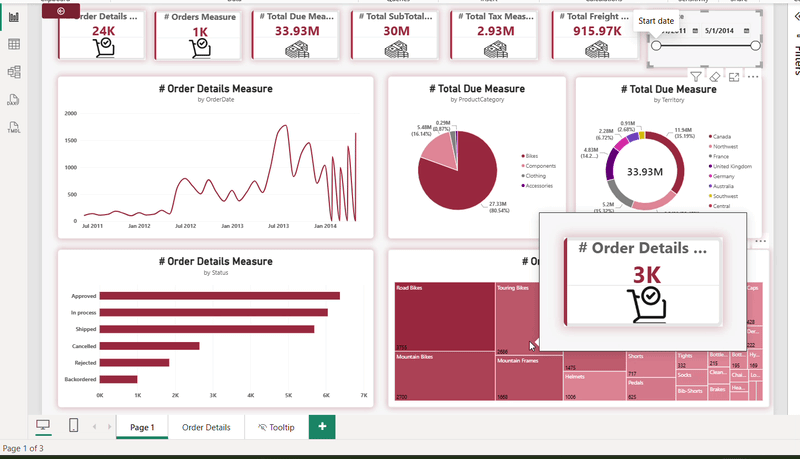

# 📊 Sales & Operations Analytics Dashboard (Power BI)

An interactive, professional-grade Power BI dashboard designed to analyze and visualize comprehensive sales data, order statuses, product categories, and regional performance metrics. 

---

## 🎥 Dashboard Preview
Here is a quick walkthrough of the dashboard in action:


*(Note: Make sure to place your GIF file inside an `assets` folder or update the path above to match your repository structure).*

---

## 🚀 Key Features & Visualizations
* **KPI Summary Cards:** High-level metrics tracking Total Orders (24K), Total Orders Measure (1K), Total Due (33.93M), SubTotal, Tax, and Freight costs[cite: 1].
* **Time-Series Analysis:** Line chart illustrating order trends and temporal patterns across dates (from Jul 2011 to May 2014)[cite: 1].
* **Category & Territory Breakdown:** 
  * Donut and Pie charts showing sales distribution across **Product Categories** (Bikes, Components, Clothing, Accessories)[cite: 1].
  * Regional distribution mapping order values across various **Territories**[cite: 1].
* **Operational Status Tracking:** Horizontal bar chart categorizing orders by status (**Approved, In Process, Shipped, Cancelled, Rejected, Backordered**)[cite: 1].
* **Hierarchical View:** Treemap visual analyzing product performance and sub-categories[cite: 1].
* **Interactive Tooltips:** Custom hover-over tooltips designed for granular insights on specific data points[cite: 1].
* **Dynamic Slicers:** Date range slider (`5/1/2011 - 5/1/2014`) for real-time filtering[cite: 1].

---

## 🛠️ Tools & Technologies Used
* **Power BI Desktop:** Data modeling, DAX measures, and interactive report building.
* **Data Visualization Best Practices:** Clean UI/UX design, custom color palette matching, and structured grid layout.

---

## 📁 Repository Structure
```text
├── assets/
│   └── dashboard-demo.gif    # Animated GIF showing the dashboard interactions
├── dataset/                  # (Optional) Sample data or schema reference
├── Sales_Dashboard.pbix      # The main Power BI project file
└── README.md                 # Project documentation
